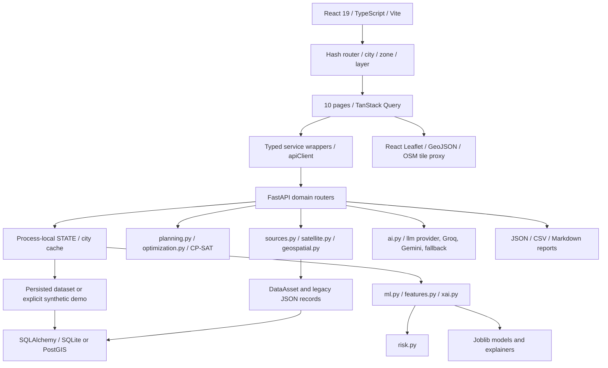

# Heatwise read-only audit and controlled implementation plan

Audit date: 10 November 2026 (Asia/Calcutta). This report describes the working tree **before this overhaul's implementation**, including pre-existing uncommitted modifications. Existing files, `.env`, and stored records are to be preserved. No application source or database was modified during the audit. Python AST parsing, a no-output TypeScript check, filesystem inspection, and SQLite `mode=ro` queries were used. External documentation was consulted; provider connectivity was not inferred from credentials or old records.

## 1. Existing architecture and dependency map

* Backend assembly: `backend/app/main.py`, eight routers in `backend/app/routes/`, Pydantic in `schemas.py` plus `schemas/ai.py`. `schemas.py` manually sets `__path__` to support the sibling schema directory.
* Active analytical path: `state.analyze()` calls `ml.train/load_or_train`, `ml.infer`, then `risk.risk`. `ml_train.py` duplicates a substantial part of `ml.py` but is not the router's implementation.
* Data path: ingestion dispatches to `sources.py` and satellite re-exports. Adapter results are saved as raw records, then indexed as assets with `analysis_ready=False`. No route promotes valid observations into an analysis dataset. The normal UI consequently has no usable analysis.
* Frontend: `App.tsx` requires successful overview, heat-map data, and an active zone before rendering **any** page. This blocks independent weather, map, assistant, and report workflows. `services/*` wrap `apiClient.ts`; legacy `api.ts` remains a compatibility wrapper. Types assume a fully populated synthetic polygon grid.
* Dependencies: FastAPI/Uvicorn/Pydantic; SQLAlchemy/GeoAlchemy2/psycopg; NumPy/Pandas/SciPy; scikit-learn/XGBoost/LightGBM/SHAP/joblib; OR-Tools; Rasterio/GeoPandas/Shapely/pyproj; HTTPX/Earth Engine/dotenv. Some direct imports are only transitively installed. Python requirements mix broad ranges with two pins, without a complete lock.
* Frontend dependencies: React, TanStack Query, Leaflet/react-leaflet, Recharts, Lucide, Radix Slot, Tailwind, Vite, TypeScript and Vitest. `package-lock.json` exists. Vite proxies `/api` to loopback port 8000; production FastAPI serves `frontend/dist` when built.
* Local startup: PowerShell/shell launch scripts; Docker multi-stage frontend/Python build; Compose PostGIS plus app. No queue, persistent source cache, or implemented Redis path. `STATE`, request cache, tiles, and rate limiting are process-local.

## 2. Complete synthetic-data dependency inventory

The following inventory separates active demo behavior, dormant unsafe helpers, scientific defaults, and downstream consumers. Random model seeds are reproducibility controls, not fabricated observations.

| Location | Synthetic or unsupported dependency | Reachability / required treatment |
|---|---|---|
| `services/data.py:sample_data` | Seed 42; arbitrary 18×18 grid; invented building density, NDVI, NDWI, NDBI, NDBaI, air temperature, humidity, rain, solar radiation, soil moisture, population, elderly share, and noise-generated SUHII | Active through explicit demo ingestion and demo environment flag. Keep only behind visible opt-in demo mode. |
| Same generator | LST = synthetic SUHII + default 33°C rural reference; 1 km² hardcoded cell area; derived roof/road/available-land shares; random protection flags; binary land cover; fixed 2025-05-15 observation date and sector names | Do not use any of these as real measurements or administrative zones. |
| `services/state.py` | Demo generation/activation, cached demo city state, model inference and risk on generated data | Normal startup correctly avoids creating a default sample, but cached demo state is not separately keyed from real state. Persisted demo activation/restart behavior is inconsistent. |
| `satellite.py:synthetic_satellite_fallback` | Fixed Landsat LST/indices, Sentinel indices, MODIS LST, invented acquisition date from requested start | Called by `fetch_landsat8`, `fetch_sentinel2`, `fetch_modis_lst` after absent credentials, empty scenes, or any failure. Remove automatic substitution. |
| `satellite.py:ingest_satellite_data` | Dispatches to fallback-capable wrappers | Exported through `sources.py`, but current `/data/ingest` uses separate lower-level error-raising adapters. Consolidate these contradictory interfaces. |
| `demographics.py:generate_synthetic_demographics` | Coordinate-derived population, age shares, poverty, housing, outdoor work and cooling access | Explicit synthetic mode can remain isolated; `ingest_demographics(...fallback_on_error=True)` must not invoke it on real acquisition failure. Module currently has no router connection. |
| `demographics.py:fetch_worldpop` | Fixed density 11,500/km² for India or 6,500 elsewhere; age shares 26/65/9%; multiplies by assumed area | Marked `synthetic=False` after a catalog request without sampling a raster. Replace. |
| `demographics.py:fetch_ghsl` | Fixed density 9,800/km²; age shares 25/66/9%; optional tile population incorrectly treated as target-area population | Marked real. Replace with spatial aggregation or explicit unavailable fields. |
| `demographics.py:fetch_census` | US county census endpoint used for Indian cities; first-row fallback; default population 15,000, age shares, poverty/housing/work/cooling values | Marked official/real. Remove all default demographics and reject unmatched geography. |
| `geospatial.py:calculate_suhii*` | Default rural reference 33°C | Require measured, comparable reference for real analysis. Arithmetic alone is not rural-reference methodology. |
| `features.py` | Missing coordinates replaced with row-index positions; missing features inserted as NaN; provenance defaults missing `synthetic` to false; unsupported `heat_index_proxy` | Do not describe unknown provenance as observed or nonspatial rows as spatial validation. Missing-data imputation requires explicit training policy. |
| `ml.py` and duplicated `ml_train.py` | Most artifacts derive from the sample grid; implicit training; model cache accepts insufficient metadata matches; predicted LST defaults rural reference to 33°C | Quarantine demo metrics/artifacts. Require input identity and verified training metadata for real predictions. |
| `xai.py` and model routes | Actual TreeSHAP computed on whichever model was trained, normally synthetic | SHAP calculation is real, but its input model is a demonstration. Retain machinery, expose its provenance and units. |
| `risk.py` | Missing SUHII defaults to 2°C; missing exposure/vulnerability becomes zero; unvalidated normalization caps/thresholds | Missing indicators can yield misleading Low risk. Return incomplete screening with null results instead. |
| `planning.py` | Eight hand-chosen cooling and water coefficients; 28 m²/tree; linear 3°C cap; arbitrary ±40% sensitivity; missing baseline defaults to 2°C, area to 1 km² | Labelled hypothetical but unsupported by evidence. Replace real-mode numerical claims with evidence/calibration-aware assumptions; never use SHAP as cooling. |
| `optimization.py` | Uses above coefficients plus population, elderly-share default 0.1 and heat default 2°C | Retain CP-SAT physical constraints; replace unsupported objectives/defaults and refuse missing suitability evidence. Financial parameters have already been removed from active request/schema/service/frontend code. |
| `llm/fallback.py`, `provider.py`, `guardrails.py` | Context hardcodes synthetic flags, missing predictions/risk to zero; template invents driver names without SHAP; action checks assume 1 km² | Provider failure returns HTTP-success template. Keep an explicitly requested local summary if useful, but failed provider requests must be reported honestly and ground in actual evidence. |
| Frontend pages/types/map | Required non-null demo metrics, synthetic-era explanatory text, default missing map values to zero, synthetic grid zone selection | Separate optional observations, predictions, scenarios and absence. |
| `routes/reports.py` | Requires demo-style state; unconditional synthetic Markdown, synthetic-model evaluation and assumed full fields | Generate evidence reports even without ML; label each included result from its actual provenance. |
| `backend/train.py` | No-input CLI silently generates/persists sample data | Require explicit demo argument; real input must be traceable and validated. |
| Tests, evidence and local storage | `conftest.py` enables demo globally and copies pre-existing model artifacts; many adapter tests mock responses; browser script expects 324 polygons and local template; old DB stores three synthetic datasets | These verify software, not observations or real model skill. Separate normal-mode, demo, mock-contract, and live end-to-end tiers. Do not delete historical data. |

No groundwater generator or real groundwater adapter was found. Missing groundwater is an unimplemented capability, not a hidden live measurement.

## 3. Frontend-to-backend API audit

| Client contract | Current result / issue |
|---|---|
| `/api/health`, `/api/cities` | Matching routes. Health checks SQL, not upstream providers; `analysis_ready=bool(STATE)` is global and can describe another city/demo. Frontend city list is also hardcoded. |
| `/api/overview`, `/api/heat/map`, `/api/heat/hotspots` | Matching routes. 409 in normal mode without a validated dataset. `App.tsx` turns this into a whole-application gate. |
| `/api/heat/predict` | GET/POST exist; accepts `features` but ignores it and returns cached zone predictions. Response contract requires all predicted fields. |
| `/api/models`, `/api/models/train`, `/api/xai/*` | Matching routes; depend on implicit `state()` analysis. SHAP responses differ by method/selection; no validated-real-model readiness contract. |
| `/api/data/ingest` | Matching client sources and route enum. Every live import explicitly remains non-analysis-ready. Satellite defaults silently choose May 2025 when dates are omitted. Optional custom coordinates can be attributed to a selected city even outside it. |
| `/api/data/status` | Frontend `DatasetCatalogItem` expects `name/type/description/live_configured/env_keys`; backend returns `id/status/resolution`. UI partly accesses undeclared fields through loose typing. Earth Engine status searches `category="satellite"`, while ingestion stores categories like `earth_engine`/`stac`. |
| `/api/data/records` | No city query; raw historical imports are unscoped. Normalized assets have no payload/detail endpoint. |
| `/api/data/series?city=` | Matching route but old weather records have no city and are excluded. Weather adapters and route both save records; daily means are described as hourly in some documentation. |
| `/api/simulation/run`, `/api/simulation/results` | Matching payload names. All results require synthetic-era zone capacities and unsupported coefficients. Missing independent scenario/suitability readiness. |
| `/api/optimization/run`, `/results` | Matching physical-only request. Stale financial tests/docs contradict implementation and brief. No live suitability inputs. |
| `/api/risk/analyze` | Matching route; incomplete data is converted to zeros and can become Low risk. |
| `/api/ai/chat` | Matching typed payload, but zone/state lookup happens before any provider request, blocking normal mode. No current environmental asset facts. Exhausted providers return a local success-shaped template. |
| `/api/reports/generate`, downloads | Matching URLs and authentication wrapper. Reports require analysis state and cannot export only current real evidence. |

The existing `apiClient` already normalizes `/api` once; middleware additionally rewrites `/api/api/`. Do not diagnose a currently fixed prefix problem as still broken. CORS origins match the documented Vite ports. However, authentication middleware runs before CORS preflight handling and can reject OPTIONS when `API_TOKEN` is enabled. Most services do not pass query cancellation signals or set timeouts, despite client support. No running-session evidence yet establishes whether a deployed origin has CORS/connectivity failures.

## 4. External data integration status

| Source | Implemented capability | Missing or unverified |
|---|---|---|
| Open-Meteo | Forecast/current request; ERA5-Land historical request; daily aggregation | Current fields incomplete; no automatic city overview; incomplete normalized timestamps/units, stale cache and source status. Current conditions are weather-model output, not a station observation. |
| NASA POWER | Daily meteorology with fill-value handling | No spatial heat inference; provenance/date integration incomplete. |
| OpenAQ v3 | Nearby location discovery and latest readings | Credentials present but unverified; no normalized sensor/pollutant/unit/station map, distance, trends or measurement freshness. |
| CPCB/state boards | None | Need verified accessible dataset/API, licensing and authentication. |
| CGWB/India-WRIS/state groundwater | None | Need genuine station observations and dates; expose unavailable until configured. |
| Overpass/OSM | Two mirrors; 1 km radius, capped 120 ways, valid GeoJSON | Partial mapping cannot be called complete building/road density or land availability. Boundary/admin search absent. |
| Landsat GEE | L8/L9 C2 L2 merge, L2SP filter, QA_PIXEL/RADSAT masks, correct thermal/reflectance scaling; median composite sampled at 1 km | No delivered LST raster, scene IDs/cloud metadata, matched rural mask, zonal pipeline, durable cache or last-valid scene selection. Project configured; authentication unverified. |
| Sentinel-2 Earth Search | Public STAC discovery and bounded COG window; aligned NDVI/NDWI/NDBI at 100 m | Only first scene; cloud mask applied after averaging can contaminate mixed pixels. No map overlay. Metadata normalization drops top-level resolution/transform. |
| Sentinel-2 GEE | Harmonized optical composites and SCL masking | No thermal band, correctly not used as LST; needs raster/zone integration. |
| MODIS | Quality-filtered daytime composites | Separate sample output only; not interchangeable with Landsat acquisition. |
| ESA WorldCover / SRTM | GEE categorical/elevation samples with historical periods | No spatial aggregation or frontend layers. |
| WorldPop/GHSL | Safe router-level catalog discovery | No population raster aggregation. Separate demographic helpers fabricate values (section 2). |
| Groq/Gemini | Real HTTP provider classes, configured model/key, discovery, retries, schema validation | Keys/models configured, but no successful provider event in local DB; only two template conversations. Actual generation and output validation still need testing. |

Existing records labelled `synthetic=False` are not accepted as proof of live acquisition: they have incomplete provenance and may come from past mocked runs. A 15-minute in-memory HTTP cache exists, but has no persistent last-known-good policy, bounded size, or credential-aware cache key. Most non-LLM adapters have no transient retry policy beyond OSM mirror switching/GDAL retry.

## 5. ML and scientific methodology

Retain RF, XGBoost, LightGBM, train-only fitted imputation, validation-RMSE winner selection, and actual TreeSHAP/additivity checks. They are useful mechanisms, not evidence of validated real-world performance.

Critical gaps:

1. Default target is synthetic SUHII; no ingestion-to-observed-label pipeline. Real input CLI requires data prepared elsewhere and writes an isolated external city namespace.
2. `check_data_provenance` treats missing provenance as real, and real-world claims depend on a boolean rather than validated lineage. Fixed-feature imputation can drop all-empty columns and then misalign SHAP feature names.
3. Default spatial partitioning is axis sorting/quantiles, despite KMeans/cross-validation claims. A named buffer fold is not necessarily a metric-distance buffer. Missing coordinates become row indices. Some fold helpers reuse validation as test; the training path needs disjointness checks. Temporal generalization is absent.
4. R²/MAE/RMSE exist; bias, residual maps, temporal holdout and versioned dataset hashes do not. Tiny holdouts can yield undefined R². Cache matching can accept `generated_at=None` for unrelated real datasets or reuse synthetic models despite changed inputs.
5. Validation residual 90th percentile is a descriptive error band; it is not automatically a calibrated 90% interval, especially after model selection and spatial shift.
6. Real SUHII requires matched urban/rural observations and justified land-cover/elevation/water exclusions. Default 33°C is not an observed reference. No weather temperature is to substitute for satellite LST.
7. A second Landsat wrapper computes NDBaI from scaled SWIR and raw thermal DN, despite a caveat elsewhere. Remove this noncommensurate index from real predictors.
8. Hazard/exposure/vulnerability screening needs transparent assumptions and null missing components. Existing fixed thresholds are not clinical validation. Population is exposure, never a replacement for vulnerability.
9. Intervention coefficients, caps and sensitivity ranges are explicitly demonstrations and lack evidence/calibration. CP-SAT feasibility does not prove parcel ownership, irrigation permission, engineering feasibility or causal cooling.

Official reference checks: [USGS scale factors](https://www.usgs.gov/faqs/how-do-i-use-a-scale-factor-landsat-level-2-science-products), [Open-Meteo model/current/forecast documentation](https://open-meteo.com/en/docs), [OpenAQ latest station measurements](https://docs.openaq.org/api/operations/location_latest_get_v3_locations__locations_id__latest_get), and [Earth Engine authentication](https://developers.google.com/earth-engine/guides/auth). These verify source semantics, not successful application requests.

## 6. UI/UX and map audit

* Retain typography/assets, shared controls, error components, responsive sidebar, hash navigation, charts and Leaflet. Improve the workflow instead of deleting functioning components.
* Replace the global analysis gate with per-capability readiness. A city with weather only must still support overview, basemap, provenance, assistant and reports.
* Existing map has valid geographic coordinates but displays the generated grid. No image/raster overlay exists: `isRasterLayer()` only names properties. No real station markers, date selector, location search, administrative boundaries, population layer, or intervention geometries.
* `MapPage` puts warning + map + detail into a two-column grid without spanning the warning; this displaces the map. Size invalidation runs only on center updates, not container resizing. Tile failures have no visible state.
* Missing properties and SHAP contributions are styled as zero. Generic Lower/Higher legends omit physical units and breaks. Tooltips always display SUHII regardless of selected layer and interpolate names as raw HTML.
* Required non-null zone fields and unconditional synthetic text are incompatible with partial real evidence. Sources, acquisition dates, native/analysis resolutions, variable kind and quality must travel with every layer.
* Navigation is module-oriented and omits Environmental Analysis. Reports/assistant remain demo-centric. No browser runtime or mobile behavior was verified during this read-only audit.

## 7. Database and environment audit

Read-only local SQLite inventory: `analysis_records=131`, `zones=972`, `schema_migrations=2`, `data_assets=0`. Three city datasets are explicitly synthetic; none has current mode/readiness metadata. Records include 44 model evaluations and test-like city identifiers, evidence of historical test pollution. Do not delete these records; isolate and ignore unverified historical data for normal mode.

Schema retains generic JSON records for datasets, observations, models, risks, scenarios, optimization, conversations and reports; PostGIS geometry exists for zones. It lacks a coherent versioned city/boundary/dataset relationship. Two additive revisions exist, but no backfill or schema-evolution validation. `save()` updates payload without refreshing timestamps; save IDs can overwrite demo/real city data. Zone persistence does not remove superseded zones. A process-wide lock covers slow training and can block unrelated cities.

`.env` was read only for **presence**, never displayed. DATABASE_URL is empty (SQLite fallback); GROQ/GEMINI key and model, Earth Engine project, Google Maps key and OpenAQ key are populated. GOOGLE_APPLICATION_CREDENTIALS, Redis and API_TOKEN are empty. Other supported local Earth Engine authentication mechanisms still require a real check. Google Maps is unnecessary for the OSM basemap; Redis is unused. `.env` SHA-256 is retained for end-of-task integrity verification.

Installed local venv includes FastAPI, Pydantic, SQLAlchemy, scientific/geospatial libraries and pytest. Python Playwright is absent. Node/npm/npx and installed TypeScript are available. Python AST parsing and `tsc --noEmit --incremental false` passed. Unit tests, build, application startup, live acquisition, provider generation and browser workflows have **not yet been rerun** at this audit checkpoint.

## 8. Prioritized plan, ownership and gates

| Priority / phase | Work | Integration gate |
|---|---|---|
| P0 — baseline and contracts | Record baseline tests; preserve worktree/.env; define evidence envelope, readiness and source states; keep normal/demo data separate; make independent city workflows possible | Normal startup and API contract tests; no manufactured observations; no source-code rewrites outside ownership |
| P0 — data integrity | Disable automatic satellite/demographic substitution; stop false real provenance and low-risk-on-missing-data; fix city attribution and persistence | Regression tests prove failures remain unavailable and no demo records enter normal evidence |
| P1 — real acquisition | Weather/current/forecasts, station pollution, dated groundwater adapter; Landsat/Sentinel/land cover/elevation and population processing where accessible; persistent provenance/cache | Actual retrieval for supported city; geometry, timestamps, units and source IDs checked; credential failures explicit |
| P1 — scientific analytics | Matched LST/SUHII; measured features; dataset/version checks, spatial/temporal splits, residuals/bias, optional SHAP; incomplete risk | Meaningful split/provenance tests; no real skill claim without real holdout; missing components shown |
| P1 — decisions and AI | Evidence-backed intervention catalog, environmental/physical constraints, no financial optimization; assistant grounded in retrieved assets and provider errors; evidence-only reporting | Solver constraint tests; unsupported estimates withheld; real provider request if configured; report export inspected |
| P1 — product/map integration | Map-first overview and environmental map; optional capability pages; observed/predicted/scenario distinction; sources, units, filters and error states | Browser tests on desktop/mobile, city changes, toggles, selection, refresh, assistant and downloads |
| P2 — final verification | Full backend/frontend tests and production build; start complete app; live retrieval and major workflows; provenance/limitations report | Test results and live evidence saved; unverified/unavailable criteria explicitly reported; no completion claim based on mocks |

### Exclusive file ownership

| Agent | Owned files / boundaries |
|---|---|
| 1 — Earth observation | `backend/app/services/satellite.py`, `geospatial.py`, new satellite-only processing modules, `test_satellite.py` and new EO tests, `docs/README_satellite.md` |
| 2 — Environmental observations | `backend/app/services/sources.py`, new `environmental.py`/weather/air/groundwater adapters and their tests; source documentation. No routers/schema/database edits. |
| 3 — Geospatial mapping | `frontend/src/components/HeatMap.tsx`, new `components/map/*`, `lib/raster.ts`, dedicated map stylesheet and map tests. No shared App/pages/types edits without handoff. |
| 4 — ML/XAI | `backend/app/services/ml.py`, `ml_train.py`, `features.py`, `xai.py`, `backend/train.py`, ML tests and methodology notes. No state/router edits. |
| 5 — Risk/mitigation | `backend/app/services/demographics.py`, `risk.py`, `planning.py`, `optimization.py`, domain tests/evidence catalog. No shared request schemas or route edits. |
| 6 — Backend/API/AI | `backend/app/main.py`, `db.py`, `migrations.py`, `provenance.py`, `schemas.py`, `schemas/*`, `routes/*`, `services/state.py`, `services/ai*.py`, `services/llm/*`, new evidence/contract services and API tests. Shared requirements/env example only through orchestrator review. |
| 7 — Product/quality | `frontend/src/App.tsx`, pages, hooks, services, types, layout/common/modal/chart components, `styles.css`, frontend tests and browser workflow script. Excludes Agent 3 map-owned files. |
| Lead orchestrator | This audit, phase contracts/verification evidence, dependency/build/runtime coordination, review and integration. Any fix in an agent-owned file waits for explicit handoff. `.env` and historical records are never rewritten. |

Seven specialists run in dependency-ordered waves, at most three concurrently with the lead. Shared interfaces are established first. Each wave delivers changed-file list, tests, data provenance and remaining limitations. Baseline tests run before implementation. No concurrent writers to shared files. No blanket reset, deletion or second project.

### Retain / refactor / replace decisions

**Retain:** stack and local startup, FastAPI routers, existing single-prefix API client, Leaflet/OSM, shared UI controls, SQLAlchemy/PostGIS capability, additive migration history, HTTP provider adapters, valid spectral formulas/quality masks, real tree models and TreeSHAP, CP-SAT constraints, multi-format exports and useful tests.

**Refactor:** state/readiness, evidence/city persistence, caching/retries/status, raster processing and geographic aggregation, schema nullability, model lineage/splits, risk missingness, provider grounding/errors, map resizing/legends/selection, navigation and reporting.

**Replace or isolate:** manufactured satellite fallbacks, falsely real demographic adapters, row-index spatial validation, fixed rural reference and missing heat defaults, unsupported real-mode cooling coefficients, invented template drivers, demo-only workflow gate, stale verification claims and browser false-success behavior. Synthetic generation remains only as explicitly labelled development/demo input.
